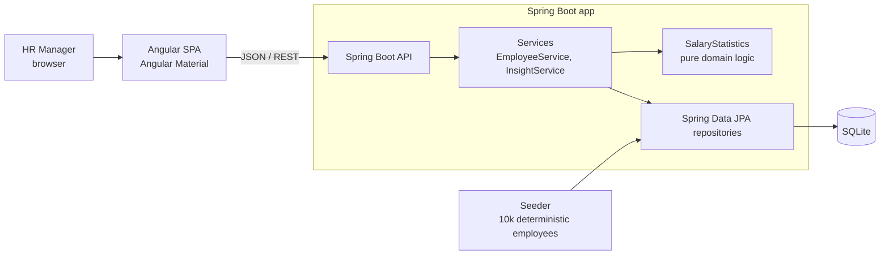

# Salary Management — Design (v1)

Companion to [REQUIREMENTS.md](REQUIREMENTS.md). This covers the architecture, data model and API,
plus the trade-offs behind each.

## 1. Architecture

- **Monorepo**: `backend/` (Spring Boot, Java 21, Maven) and `frontend/` (Angular, standalone components + signals).
- **One deployable**: the Angular production build is served by Spring Boot as static files, so we ship
  one Docker image, have no CORS in production and keep deployment simple.
- **Layering**: controller (HTTP + validation) → service (use cases) → repository (persistence).
  The statistics maths (median, etc.) lives in a framework-free `SalaryStatistics` class so it can be
  unit-tested in milliseconds without Spring.

## 2. Data model

One table, kept deliberately small.

**`employee`**

| Column | Type | Notes |
|---|---|---|
| `id` | INTEGER PK | surrogate key |
| `employee_code` | TEXT, **unique** | business key, e.g. `EMP-00042` |
| `full_name` | TEXT, not null | |
| `job_title` | TEXT, not null | |
| `department` | TEXT, not null | |
| `country_code` | TEXT(2), not null | ISO-3166 alpha-2 (`IN`, `US`, …) |
| `annual_salary` | DECIMAL(15,2), not null, > 0 | in the country's local currency |
| `employment_type` | TEXT, not null | `FULL_TIME` / `PART_TIME` / `CONTRACT` |
| `hire_date` | DATE, not null | not in the future |
| `created_at`, `updated_at` | TIMESTAMP | audit basics |

**Indexes:** `employee_code` (unique), `country_code`, `(country_code, job_title)`, `(country_code, department)`.
These match the list filters and the insight group-bys.

**`Country` enum (in code, not a table):** code → display name + ISO-4217 currency (`IN` → India, `INR`).
Currency is **derived**, never stored per employee, so a salary can't end up recorded in the wrong
currency for its country.

**Schema ownership:** the schema is a Flyway migration (`db/migration/V1__create_employee.sql`), and
Hibernate DDL generation is off. *Why:* the persistence tests showed that Hibernate's SQLite dialect
silently drops unique constraints, which would have allowed duplicate employee codes. A custom
`ConstraintAwareSQLiteDialect` also maps SQLite constraint errors to `DataIntegrityViolationException`,
so a duplicate that slips past the service-level check (a race) still becomes a clean 409. The
database also enforces `annual_salary > 0` and the enum values as a last line of defence.

**Trade-offs**
- *Job title / department are plain strings, not lookup tables.* That's simpler for v1, and the filter
  dropdowns come from `SELECT DISTINCT`. The cost is typo risk ("Engineer" vs "Enginer"). Normalising
  them would be the next step once HR wants to rename titles centrally.
- *`BigDecimal` for money.* Floating point is never used for salaries.
- *Current salary only.* There's no history table (out of scope), so an update overwrites. `updated_at`
  gives a minimal trace.

## 3. API

Base path `/api`. JSON in and out. Errors use RFC 7807 `ProblemDetail`.

### Employees
| Method & path | Purpose | Responses |
|---|---|---|
| `GET /employees?search=&country=&department=&jobTitle=&page=0&size=20&sort=annualSalary,desc` | Paginated, filterable list | 200 `Page<EmployeeResponse>` |
| `GET /employees/{id}` | One employee | 200 / 404 |
| `POST /employees` | Create | 201 + `Location` / 400 validation / 409 duplicate code |
| `PUT /employees/{id}` | Full update (everything except the employee code) | 200 / 400 / 404 |
| `DELETE /employees/{id}` | Delete | 204 / 404 |

- `search` matches name or employee code (case-insensitive, contains). Page size defaults to 20, capped at 100.
- **The employee code is immutable.** It's the business identifier other systems (payroll, HRIS) refer to,
  so `PUT` doesn't accept it. That removes a whole class of "renamed the key" bugs and the 409-on-update case.
- **Sort fields are whitelisted** (`fullName`, `employeeCode`, `jobTitle`, `department`, `country`, `annualSalary`,
  `hireDate`). Anything else is a 400, not a 500 from deep inside JPA.
- Validation errors return `400` with an `errors` map (`field → message`) so the UI can mark the right input.

### Reference data
| `GET /meta/filters` | Countries (code, name, currency), departments, job titles for dropdowns |
|---|---|

### Insights
| Method & path | Answers |
|---|---|
| `GET /insights/countries` | Per country: headcount, min, max, average, median, total payroll, currency |
| `GET /insights/countries/{code}/job-titles` | "What do we pay role X in country Y?" — the same stats per job title |
| `GET /insights/countries/{code}/departments` | Headcount and total payroll per department in a country |

**How the stats are computed** *(revised during implementation)*: each endpoint runs **one** projection query
that returns only `(group, salary)` pairs, never whole entities. **All** figures (count, min, max, average,
median, total) are then computed by `SalaryStatistics`. I originally planned SQL `GROUP BY` for the simple
aggregates plus Java for the median, but that splits the maths across two places with two rounding behaviours.
A single code path is simpler and fully unit-tested, and at 10k rows it costs milliseconds. SQLite has no
`percentile_cont` anyway. *At ~1M rows I'd move to Postgres and push aggregation into SQL
(`percentile_cont` for the median), or precompute aggregates on write.*

Response shapes: `/insights/countries` → `[{country, countryName, currency, headcount, min, max, average, median,
totalPayroll}]` (only countries with employees); the per-country breakdowns →
`{country, countryName, currency, groups: [{name, headcount, min, max, average, median, totalPayroll}]}`, sorted by
name. A country with no employees gets an empty `groups` list, not a 404.

## 4. Frontend

| Route | Screen |
|---|---|
| `/employees` | Material table: search box, country/department/title filters, sortable columns, server-side paginator |
| `/employees/new`, `/employees/:id/edit` | Reactive form with validation mirroring the backend; currency shown from the selected country |
| `/insights` | Country cards (headcount, median, payroll) → choose a country → job-title and department tables |

**Mixed-currency rule (found while building the list):** salaries are stored in local currency, so sorting
the whole company by salary would put ₹1,800,000 above $150,000. The list therefore **only allows a salary
sort once a single country is selected**. The header is disabled with a tooltip and a hint explains why. If
the country is cleared mid-sort, the list falls back to name order. Currency is shown as an unambiguous symbol
(`SGD 76,600`, never a bare `$` that reads as USD). The real fix, FX conversion with an as-of date, stays out
of scope (see requirements).

**List UX details:** search is debounced (300 ms). Any filter, sort or page-size change returns to page 1. The
previous page stays on screen while the next loads, so the table doesn't flicker. Network failures show a plain
message with a retry button.

State is held in services/components with Angular **signals**. There's no NgRx: the app has two features
and no cross-feature shared state, so a store would be ceremony.

## 5. Seed data
- Deterministic (`Random(42)`), so every run and every reviewer gets the same 10,000 employees.
- 6 countries × 8 departments × ~20 titles. The salary is `base band (country, title) × level multiplier ± noise`,
  so the insights look realistic (e.g. US engineer > India engineer in absolute terms).
- Runs on startup **only when the table is empty**, so restarts never duplicate or overwrite data HR has entered
  (disable it with `salary.seed.enabled=false`).
- *(Revised during implementation)* It uses JPA `saveAll` in batches of 500 inside **one** transaction, flushing and
  clearing the persistence context between batches. **Measured: 10,000 employees in ~4.9 s** on my laptop. That's a
  one-off cost on an empty database. Plain JDBC batch inserts would be roughly 10× faster, but they would duplicate
  the entity mapping (timestamps and date formats in SQLite), so I chose the simpler, consistent path.
- Measured API latency on the seeded database: list page 60–220 ms, country insights ~110 ms, job-title
  breakdown ~65 ms. That's within the < 500 ms goal.

## 6. Testing strategy
| Level | What | Tooling |
|---|---|---|
| Unit | `SalaryStatistics` (odd/even median, single value, empty), validation rules, seed determinism and distribution | JUnit 5, AssertJ |
| Service | duplicate employee code → conflict, update/delete of missing id → not found | JUnit + Mockito |
| Web slice | request validation, status codes, ProblemDetail shape, paging params | `@WebMvcTest` |
| Persistence | filter/search queries and the group-by aggregates against real SQLite (in-memory) | `@DataJpaTest` |
| Frontend | form validation, service URL/params mapping | Angular test runner |

The aim is for tests to stay **fast and deterministic**: no network, a fixed seed, and no wall-clock time
in assertions.

## 7. Planned commit sequence
1. Backend scaffold + health check
2. `SalaryStatistics` (test-first)
3. `Employee` entity, repository and persistence tests
4. Employee CRUD service + API + tests
5. Insights service + API + tests
6. Deterministic 10k seeder
7. Angular scaffold + API client
8. Employee list (filters, paging, sorting)
9. Create/edit form
10. Insights screens
11. Single-image Docker build + deployment
12. README, AI-workflow notes, demo video link

## 8. AI usage (tracked in `docs/AI_WORKFLOW.md`)
AI is used to draft scaffolding, tests and boilerplate. Every design decision above is made and reviewed by
me. Prompts, and the cases where AI output was rejected or corrected, are logged as I go.
